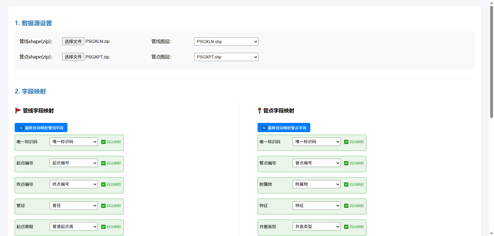
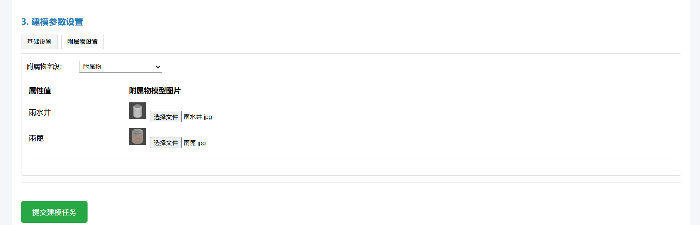
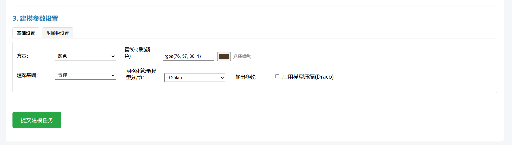

## Pipeline Model (管线/管点三维建模与三维瓦片发布)

### 概述
- **目标**: 从管线/管点 SHP 数据生成 3D 模型（OBJ/MTL）并转换为 3D Tiles（B3DM），支持颜色/贴图两种渲染方案与分片导出。
- **技术栈**: Spring Boot 后端 + 原生前端静态页（`src/main/resources/static`）+ `obj23dtiles` 转换。
- **核心能力**:
  - 管线（圆柱体）与管点（圆柱体/长方体）几何构建
  - 材质（颜色/贴图）、附属物贴图按字段映射
  - 网格化空间分片（切瓦片）
  - BatchTable 仅包含原始属性字段（不含系统字段）
  - OBJ/MTL 导出与贴图文件自动复制
  - 3D Tiles（B3DM）转换与 tileset 生成
  - 管线/管点双面几何（防止背面剔除造成“镂空”）

---

### 目录结构
```text
src/main/java/com/bdtdgis/
  PipeModelApplication.java             # Spring Boot 启动类
  model/                                # Mesh/Face/Vertex 等几何模型
  service/ModelService.java             # 任务编排：读SHP→分片→导出→转换
  util/
    PipeMeshBuilder.java                # 管线/管点网格生成（含埋深基础）
    ObjExporter.java                    # OBJ/MTL 写出（含 map_Kd 纹理）
    BatchTableUtil.java                 # batch_table.json 生成（仅原始属性）
    CustomSpatialTilesUtil.java         # 空间分片、区域分配
src/main/resources/static/              # 前端静态页面
  index.html                            # UI：数据源/字段映射/建模参数
  js/app.js                             # 前端交互逻辑
```

---

### 构建与运行
- 先决条件: JDK 8+、Maven、已安装 `obj23dtiles`（PATH 可用）。
- 开发运行:
```bash
mvn spring-boot:run
```
- 生产构建:
```bash
mvn clean package
java -jar target/pipe-model-1.0.0.jar
```
- 访问: `http://localhost:8080/`（静态页面）

---

### 使用流程
1. 数据源设置
   - 上传管线/管点 SHP 压缩包（zip），并选择图层（.shp）。
2. 字段映射
   - 管线：唯一标识、起点编号、终点编号、管径、起/终点高程等
   - 管点：唯一标识、管点编号、附属物、特征、井盖类型等
3. 建模参数
   - 方案：颜色 / 贴图
   - 管线材质（颜色或贴图文件）
   - 网格化管理（模型分片）
   - 输出参数：是否启用 Draco 压缩
   - 埋深基础（Depth Base）：管顶 / 管心 / 管底
4. 附属物设置（可选）
   - 选择“附属物字段”，为各“属性值”上传对应贴图（或后续扩展为预制模型）。
5. 提交建模任务
   - 后端完成 OBJ/MTL 导出、贴图复制、3D Tiles 转换，生成 tileset 目录。

---

### 埋深基础（Depth Base）计算逻辑（已统一到"管心坐标系"）
- 传入几何构建的起终点坐标始终代表"管线中心轴"。
- 根据选择对中心轴进行平移，以保证"最终几何"的顶部/中心/底部与地面（SHP Z）对齐。
  - 管顶（top）: 中心轴下移 `radius`，最终"管顶 = 地面Z"
  - 管心（center）: 中心轴不变，最终"管心 = 地面Z"
  - 管底（bottom）: 中心轴上移 `radius`，最终"管底 = 地面Z`
- 管点：根据埋深基础统一调整坐标和高度，确保与管线完美对齐
  - 管顶（top）: 管点坐标下移 `radius`，高度增加 `radius`，最终"管点顶部 = 地面Z"
  - 管心（center）: 管点坐标下移 `height/2`，高度不变，最终"管点中心 = 地面Z"
  - 管底（bottom）: 管点坐标不变，高度不变，最终"管点底部 = 地面Z"

---

### 贴图与材质
- 后端在 MTL 中写入 `map_Kd`，并自动复制贴图至 OBJ 输出目录，确保转换与预览可用。
- 管点支持“按字段→贴图”映射；如需更逼真效果，建议后续接入“预制模型按类型放置”。

---

### 批表（Batch Table）
- `Mesh.originalAttributes` 保存“仅用户原始字段”。
- 生成 `batch_table.json` 时只使用 `originalAttributes`，不再附加系统字段（如 batchId、name 等）。

---

### 空间分片与坐标
- 使用 `CustomSpatialTilesUtil` 进行网格化分片，减少单瓦片体量。
- 支持在更高层做去中心化（模型在各自瓦片坐标系内）。

---

### 前端界面截图
> 将以下图片保存到 `docs/screenshots/` 目录，并按名称放置即可在 README 中显示。

- 数据源设置与字段映射：



- 附属物设置：



- 建模参数（含埋深基础）：



---

### 常见问题（FAQ）
- 模型看起来“镂空”或缺面？
  - 已启用双面几何；若仍出现，检查法线/环绕顺序与查看器背面剔除设置。
- 贴图未显示？
  - 确认 MTL 中 `map_Kd` 指向的纹理文件与 OBJ 同目录；前端方案选择为“贴图”。
- 管线与管点在接口处出现轻微错位？
  - 已修复：管点现在根据埋深基础（Depth Base）参数统一调整坐标和高度，确保与管线完美对齐。
  - 选择"管顶"时，管点坐标下移 `radius`，高度增加 `radius`，与管线顶部对齐。
  - 选择"管心"时，管点坐标下移 `height/2`，与管线中心对齐。
  - 选择"管底"时，管点坐标不变，与管线底部对齐。

---

### 后续规划
- 管点按“类型”放置预制 3D 模型（如雨水井、雨箅），替代单纯贴图（已完成）。
- 更丰富的材质与法线/UV 生成策略。
- 坐标基准与地形/倾斜摄影对齐策略。

---

### 许可证
- 内部项目，未设置公开许可证。如需开源请补充 LICENSE。 